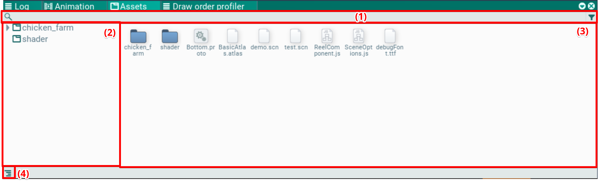

## Assets. Assets window

This window shows the assets of the game; they can be edited or dragged onto the scene.

The left side shows the folder hierarchy (2). Selecting a folder shows its assets in the files pane (3). The button (4) toggles the folder pane on and off.

At the top there is a filter for searching by name (1). Next to it the view button switches the files pane between Grid, List and Table in a circle; its icon shows the current view, the project config keeps it (`assetsView`). Grid shows icons with the name in up to three lines, a longer name is cut after the third one. List shows a row per asset: a small icon and the name. Table adds the columns Type, Size and Modified, light lines between them, under a header without a back; a click on a column title sorts by it, a second click turns the direction, the arrow by the title shows it. Folders always go first. The selection stays when the view changes. The hover slides to the asset under the cursor and fades in and out, as the one of the folders tree does. A video shows the frame of its start with a play badge outlined light; a sound shows the icon of the sounds, a page with notes. They are played in the Properties window and in the Preview window.

Assets and folders can be moved into folders via drag'n'drop. They can be copied, pasted and deleted. The functionality is much like a typical OS file browser.

New assets are created through the context menu, the Create item.

Clicking an asset selects it, and the Properties window shows its settings. There, for example, atlas and texture parameters and font styles can be changed.

Some asset types support drag'n'drop into the hierarchy or the scene: textures and prototypes. Just drag them to the desired place.

The context menu item Rename (F2) renames the selected asset in any view; in the grid a double click on the asset name does it too. Double-clicking an asset icon, or a row of the list and the table, opens the asset, depending on its type:
- folder — opens the folder;
- scene — opens the scene in the editor;
- prototype — instantiates it into the current scene (with undo support);
- JavaScript script — opens the source in the system editor (on the web version — in the built-in text editor of the assets page);
- other assets — brings up the Properties window with the selection.

### Texture and atlas settings

Selecting an atlas or a texture allows editing its parameters; the settings appear in the Properties window. As soon as the file is deselected, it is saved automatically. It can also be saved with the Save button in the Properties window header.

When a texture is selected, its preview is shown, and the margins for a 9-slice sprite can be edited on top of it.

The Atlas field references the atlas the texture is packed into. To set the atlas, drag it into this field from the assets window.

When a vector image (`.svg`) is selected, the Properties window shows it drawn over the checker with the 9-slice margins to drag, its size, the shapes and triangles count, how it is drawn (the rasters in the atlas, the baked mesh, the mesh for any scale or for each scale) and the parsing error or warnings. The fields Slice Border, Default Mode, Scalable Mesh and Rasterized are the ones of its meta.

Previews of the other assets in the Properties window: a font - lines of text of a few sizes; a mesh and a skinned model - the model in a 3D view (the left button orbits, the right one pans, the wheel zooms), the vertices, the triangles, the joints and the animation clips; a sound - its duration, sample rate, channels and size, and the player of the pipeline audio node: the play button, the waveform to click or drag for the time, the time and the loop; a video - its frame size, frame rate, duration and size, the frame with a play button while paused (a click on the frame plays or pauses) over the same transport bar. The players keep playing while the Properties window refreshes. A clip shorter than a minute shows its time in tenths of a second. An image, an atlas, a vector image, a font, a model and a video have Open preview (a font also Open atlas): it opens the Preview window, where the asset is looked at closer. Its modes, chosen in the toolbar: an image - Image and Atlas page (the whole page, the image framed); an atlas - its pages with the images framed; a vector image - Image (a sprite of the view scale, sharp at any zoom), Mesh (the triangles the sprite takes at the zoom over it) and Rasters (the page of the vector rasters with the cells of the image framed, while its sprites are drawn); a font - Text (the sizes 10 to 48) and Atlas (the glyphs drawn so far); a model - Shaded, Wireframe, Shaded wireframe, and the clips of a skinned model with Play; a video - its player; a sound - its waveform large across the window, a click or a drag on it moves the time, the transport bar under it. The textures are shown by the inspector of the Textures window (channels, background, zoom, the pixel under the cursor), its controls stand in the one toolbar row of the window; Fit fits the view. The info of the mode is the line at the bottom, for a texture together with its size and the pixel under the cursor. The models keep Y up, as glTF and OBJ do.

When an atlas is selected, its parameters are shown in the Properties window as well.

It has common atlas settings (Common) and platform-specific ones (you likely don't need those). The common settings define the maximum atlas page size (an atlas may be packed into several pages), the compression format and the padding between textures when packing.
