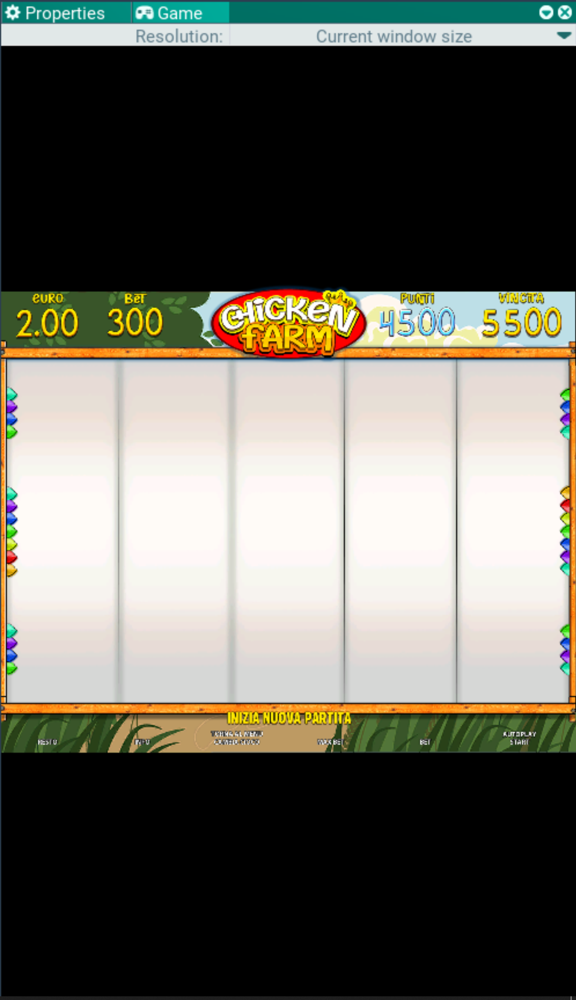

## Game. Game window

This window shows the game as if it were running as a standalone application. Rendering goes properly through the cameras. Mouse clicks are handled.

The panel at the top selects the emulated device - the same list as the o2 portal's players: iPhones, Pixel and Galaxy
phones, iPads, Steam Deck, desktop windows, or "Fit to window", where the game takes the window's own size. A device:

- draws the game in its real screen pixels (an iPhone 16 renders 1179x2556) and fits that picture into the window;
- is drawn around the picture as the real thing: the frame, the bezels, the island or the camera, the home bar, the side
  buttons; the screen's corners are rounded as on the device;
- gives the game its safe area (the island, the home bar; `o2Integration.GetSafeAreaInsets()` in the game's pixels), so
  `SafeArea` widgets lay the interface out as on the phone;
- turns on its side with the Portrait / Landscape button.

The choice is kept in the project's `EditorConfig.json` (`gameDevice`, `gameDeviceLandscape`).

Zoom and pan, as in Unity's Game view: Alt + wheel zooms around the cursor, the middle button or Alt + left button drags
the picture, `-` / `+` zoom around the middle, the zoom button ("Fit" or the percentage) fits the picture again. The game
gets its clicks wherever its picture is drawn; while Alt is held over the picture or it is dragged the mouse is the
window's, and clicks outside the window are not the game's.
