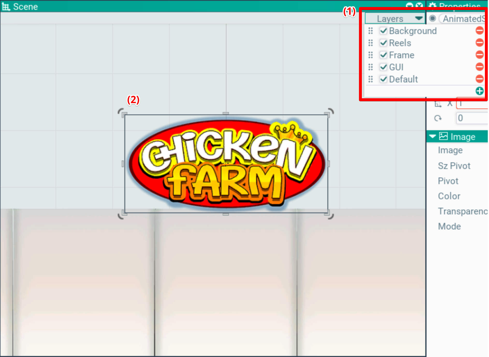

## Scene. Scene window

This window shows the actors of the scene in layer order, independently of the camera. The scene can be scrolled and zoomed. Scroll with the right mouse button held, zoom with the wheel.

A grid is drawn in the background. The grid step depends on the zoom (powers of ten), every tenth line is highlighted.

Actors are selected with the left mouse button. Clicking the same point repeatedly cycles the selection from top to bottom. This way the desired node in the hierarchy can be selected with several clicks.

The active tool selected in the toolbar is also shown (2). It is interactive and works like in other editors.

The active tool may have special modes activated by holding Shift/Ctrl/Alt. Among them — snapping, axis alignment and others.

### Spline editing
Components with a spline (spline colliders and others) activate the spline tool when selected in the inspector. Points are added with a double click, removed with Delete. Dragging a point's bezier supports keeps them symmetric; with Alt held they move independently, and an Alt-click resets a support to zero.

A selected point also shows a corner rounding handle on the corner bisector (as in Illustrator/Figma). Dragging it into the corner rounds it: the point slides along the bisector and the supports lay on the arc tangent. Dragging back to the base offset restores a sharp corner. The rounding is limited by halves of the adjacent edges.

### Layers
The scene window allows configuring layers and their order. Click Layers at the top (1).

In the dropdown menu they can be reordered via drag'n'drop, created, deleted, renamed by double-click, and enabled/disabled with the checkbox.

### Gizmos and selection
The Gizmos button on the top opens the view display panel. The Gizmos switch turns off gizmos
entirely, below it is the list of actor and component types which draw gizmos: each one is switched
separately. The list contains the types which override `OnDrawGizmos` and are present on the current
scene (colliders, joints, cameras) — it is collected from the whole scene, so a type can be switched
off before anything of it is selected. Gizmos are drawn for the selected objects only, down their
children — the same hierarchy the selection outline covers — and work in both 2D and 3D view mode.

The last row, under a separator, is the Selection switch — it turns off drawing of the objects
selection: the transform frames and the silhouette outline of the selected content. The outline is
drawn in both modes: in 3D over the 3D components content, in 2D over the 2D graphics. The silhouette
covers the whole enabled hierarchy of the selected actor — its drawing components and the components
of all its children; disabled objects and components are skipped, widget layers are not included.

### Render mode
The render mode button at the top shows the mode and opens the menu of the modes (`SceneEditScreen::SetRenderMode`, `SceneRenderMode`):
- **Scene camera** (default) — through the render pipeline of the first scene camera, so the picture matches the game.
- **Stable camera** — through the default forward 3D/2D pipeline: a custom pipeline (offscreen passes, screen shaders) can distort the editing view.
- **Unlit** — the default pipeline without the baked shading of the 3D meshes (`ScenePassFilters::SetRawAlbedoMode`); 2D has no lighting.
- **Wireframe** — the edges of the triangles in lines, without the fill and the textures.
- **Shaded wireframe** — the edges over the filled triangles.
- **Overdraw** — the triangles add a constant color up over a dark background, without textures: the brighter, the more layers are drawn there.

Every mode but Scene camera draws through the default pipeline. The debug modes apply to the scene content only: the grid, the selection, the gizmos and the other windows are drawn as they are (`Render::SetDebugDrawMode`, see [render](/Docs/en/Architecture/LowLevel/render.md)). A raster of a vector sprite from the atlas is two triangles in Wireframe and Overdraw.
