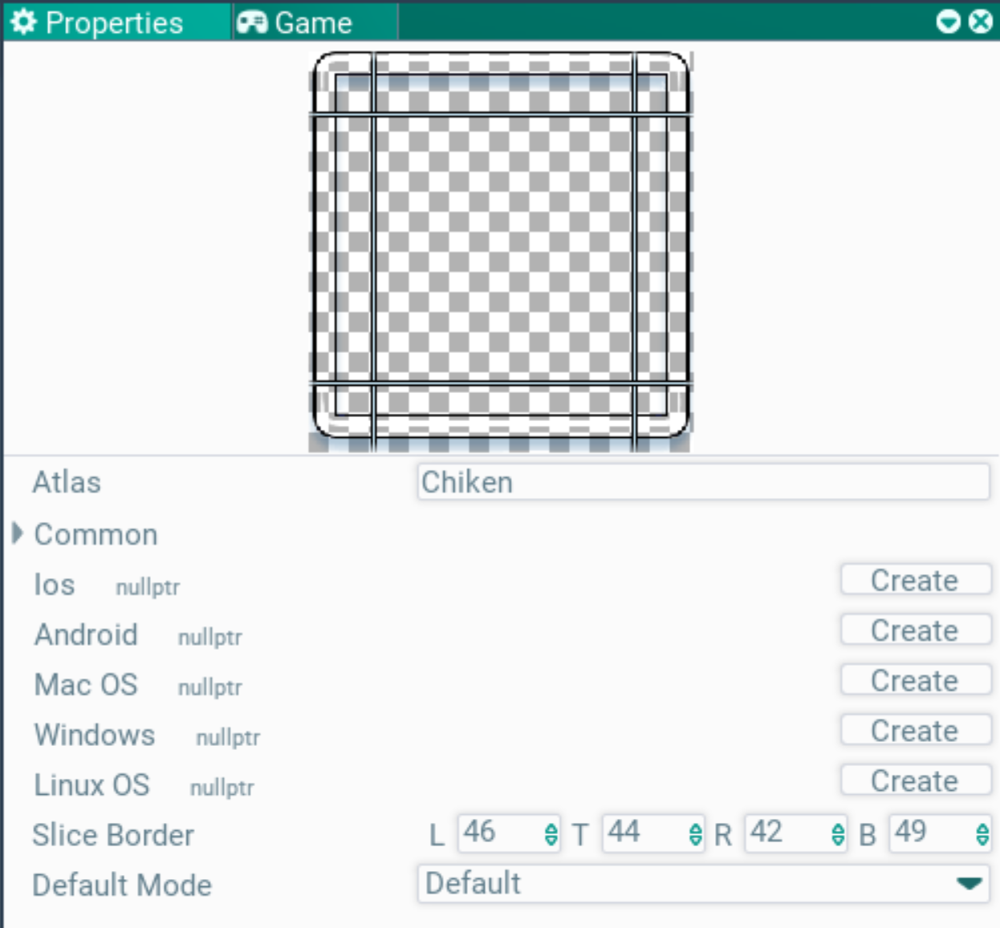
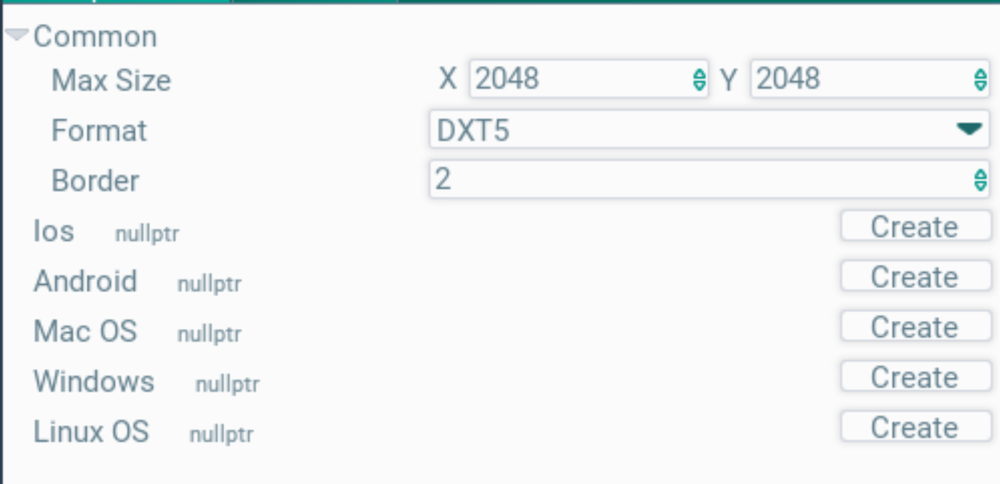

## Assets. Окно ассетов

В этом окне можно увидеть ассеты, которые есть в игре, отредактировать их или "вытащить" на сцену.

Слева в окне отображена иерархия папок (2). Выбрав папку, в окне файлов (3) покажутся ассеты в выбранной папке. По кнопке (4) можно включать и выключать отображение папок.

Сверху есть фильтр для поиска по имени (1). Рядом с ним кнопка вида переключает панель файлов по кругу: Grid, List, Table; её иконка показывает текущий вид, он хранится в конфиге проекта (`assetsView`). Grid — иконки с именем до трёх строк, более длинное имя обрезается после третьей. List — строка на ассет: маленькая иконка и имя. Table добавляет столбцы Type, Size и Modified с лёгкими линиями между ними, под заголовком без фона; клик по заголовку столбца сортирует по нему, повторный клик меняет направление, стрелка у заголовка показывает его. Папки всегда идут первыми. Выделение при смене вида сохраняется. Подсветка плавно переезжает к ассету под курсором, появляется и гаснет так же, как у дерева папок. Видео показывает кадр своего начала со значком play в светлой обводке; звук — иконку звуков, лист с нотами. Проигрываются они в окне Properties и в окне Preview.

Ассеты и папки можно перемещать с помощью drag'n'drop в папки. Можно копировать, вставлять и удалять. Функционал практически аналогичен типичному обозревателю файлов в ОС.

Создавать новые ассеты можно через контекстное меню, пункт Create.

По клику на ассет его можно выделить, и тогда в окне Properties покажутся его настройки. Там, например, можно изменять параметры атласов и текстур, стили шрифтов.

Для некоторых типов ассетов работает drag'n'drop в иерархию или сцену: текстуры и прототипы. Для этого их просто нужно перетащить в нужное место.

Пункт контекстного меню Rename (F2) переименовывает выбранный ассет в любом виде; в сетке это делает и двойной клик по имени ассета. Двойной клик по иконке ассета, а в списке и таблице — по строке, открывает его, в зависимости от типа:
- папка — открывается папка;
- сцена — открывается в редакторе;
- прототип — добавляется на текущую сцену (с поддержкой undo);
- JavaScript-скрипт — исходник открывается в системном редакторе (в веб-версии — во встроенном текстовом редакторе страницы ассетов);
- остальные ассеты — показывается окно Properties с выделением.

### Настройка текстур и атласов

Выбрав нужный атлас или текстуру можно настроить их параметры. настройки отобразятся в окне Properties. Как только выделение с файла будет снято - он будет автоматически сохранен. Также сохранить можно кнопкой Save в заголовке окна Properties.

При выборе текстуры отображается ее превью, поверх которого можно отредактировать отступы для 9-slice спрайта.

В поле Atlas задается ссылка на атлас, в который попадет текстура. Чтобы задать атлас, нужно его перетащить drg'n'drop-ом в это поле из окна ассетов.

При выборе векторной картинки (`.svg`) окно Properties показывает её поверх шахматного фона с отступами 9-slice, которые можно тянуть, её размер, число фигур и треугольников, чем она рисуется (растрами из атласа, запечённым мешем, мешем под любой масштаб или под каждый масштаб) и ошибку разбора или предупреждения. Поля Slice Border, Default Mode, Scalable Mesh и Rasterized — поля её меты.

Превью остальных ассетов в окне Properties: шрифт — строки текста нескольких размеров; меш и скелетная модель — модель в 3D-виде (левая кнопка вращает, правая двигает, колесо приближает), вершины, треугольники, кости и клипы анимации; звук — длительность, частота, каналы и размер и плеер аудио-ноды пайплайнов: кнопка play, волна, по которой кликом или перетаскиванием выбирается время, время и loop; видео — размер кадра, частота кадров, длительность и размер, кадр с кнопкой play на паузе (клик по кадру запускает и ставит на паузу) над той же панелью транспорта. Плееры продолжают играть, пока окно Properties обновляется. Клип короче минуты показывает время в десятых секунды. У картинки, атласа, векторной картинки, шрифта, модели и видео есть Open preview (у шрифта ещё Open atlas): открывает окно Preview, где ассет рассматривается подробнее. Его режимы выбираются в панели: картинка — Image и Atlas page (вся страница, картинка в рамке); атлас — его страницы с картинками в рамках; векторная картинка — Image (спрайт масштаба вида, резкий при любом зуме), Mesh (треугольники, которые спрайт берёт при этом зуме, поверх него) и Rasters (страница векторных растров с ячейками картинки в рамках, пока её спрайты рисуются); шрифт — Text (размеры от 10 до 48) и Atlas (нарисованные пока глифы); модель — Shaded, Wireframe, Shaded wireframe и клипы скелетной модели с Play; видео — его плеер; звук — волна крупно на всё окно, клик или перетаскивание по ней двигает время, под ней панель транспорта. Текстуры показывает инспектор окна Textures (каналы, фон, зум, пиксель под курсором), его контролы стоят в одной строке панели окна; Fit вписывает вид. Информация режима — строка внизу, у текстуры вместе с её размером и пикселем под курсором. Модели держат Y вверх, как glTF и OBJ.

При выборе атласа показываются его параметры, так же в окне Properties.

В нем есть общие настройки атласа (Common) и платформо-зависимые (вам это не нужно по идее). Внутри общих настроек можно задать максимальный размер страницы атласа (может быть упакован в несколько страниц), формат сжатия и отступы для текстур при упаковке.
