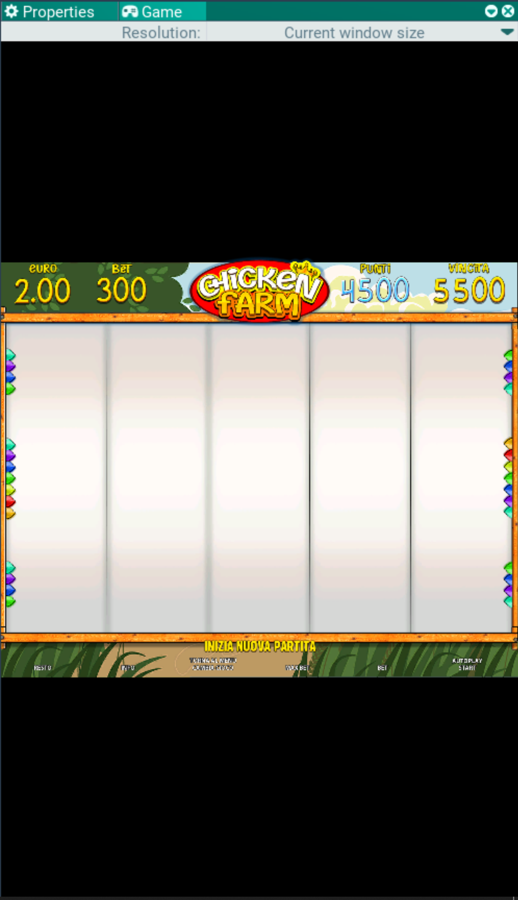

## Game. Окно игры

В этом окне отображается игра, как будто она запущена отдельным приложением. Отрисовка происходит честно через камеры. Обрабатываются клики мышкой.

Сверху в панели выбирается эмулируемое устройство - тот же список, что в плеерах портала o2: iPhone, телефоны Pixel и
Galaxy, iPad, Steam Deck, окна рабочего стола, или «Fit to window», где игра получает собственный размер окна. Устройство:

- рисует игру в реальных пикселях своего экрана (iPhone 16 - 1179x2556) и вписывает эту картинку в окно;
- рисуется вокруг картинки как настоящее: рамка, поля, островок или камера, полоска «домой», боковые кнопки; углы экрана
  скруглены как у устройства;
- отдаёт игре свою безопасную область (островок, полоска «домой»; `o2Integration.GetSafeAreaInsets()` в пикселях игры),
  и виджеты `SafeArea` раскладывают интерфейс как на телефоне;
- поворачивается на бок кнопкой Portrait / Landscape.

Выбор хранится в `EditorConfig.json` проекта (`gameDevice`, `gameDeviceLandscape`).

Зум и панорама, как в окне Game у Unity: Alt + колесо приближает к курсору, средняя кнопка или Alt + левая кнопка тянет
картинку, `-` / `+` масштабируют вокруг середины, кнопка зума («Fit» или проценты) снова вписывает картинку. Игра получает
клики там, где нарисована её картинка; пока Alt зажат над картинкой или её тянут, мышь принадлежит окну, а клики за
пределами окна игре не достаются.