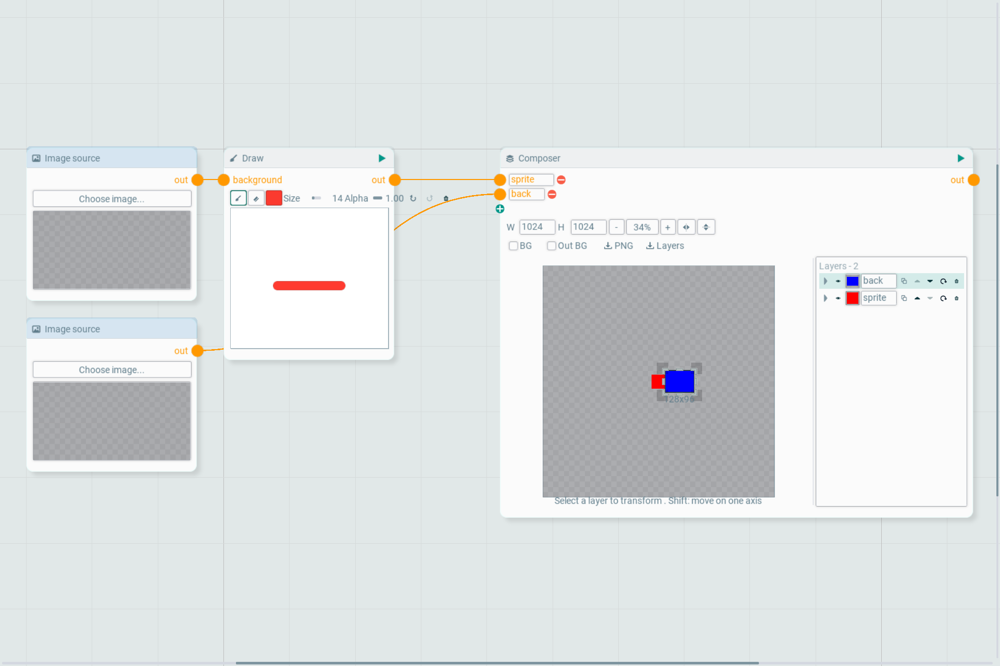

## Pipeline. Окно AI-пайплайнов

Редактирует ассет `.pipeline`: граф нод, который превращает текст, картинки и звуки в игровые ассеты с помощью AI-провайдеров и локальной обработки. Открывается из окна ассетов (двойной клик по ассету пайплайна, `Create/Pipeline` в контекстном меню создаёт новый) или через `View/Show Pipeline`. Файл - это документ пайплайна AssetsLine (JSON), тот же, что хранит веб-редактор AssetsLine, поэтому пайплайн переходит между ними без изменений.

Окно - это холст с карточками нод. Панель инструментов запускает весь граф (каждый конец ветки, поэтому цепочка, которую не забирает ни одна финишная нода, тоже выполняется), останавливает выполнение, вписывает граф в окно и импортирует файл AssetsLine; справа `Save all` записывает в ассеты то, что показывают все финишные ноды и композеры (из результатов на экране, ничего не генерируя), а шестерёнка открывает окно настроек на последней открытой вкладке (`Edit/Project/AssetsLine` - на `AssetsLine`): `AssetsLine` (связь), `API keys` (Gemini, OpenAI, OpenRouter, ElevenLabs, Kling), `Local agents` (см. ниже) и `Editor` (вид картиночных нод, `Python 3` для AI image to UI - `imageToUiPython`, пустое - искать); окно подгоняется под показанную вкладку, всё хранится в `Work/Pipelines/PipelineSettings.json`. Строка статуса показывает лог исполнителя.

### Тема
Холст и карточки бывают в двух темах и следуют теме редактора ([темы](/Docs/ru/Editor/editor.md)): тёмная при тёмном редакторе, светлая при светлом; в `.pipeline` ничего не пишется.
- **Тёмная** - вид веб-редактора AssetsLine: радиальный градиент холста с точками, полупрозрачные карточки со стеклянной кромкой и мягкой тенью, шрифты Geologica / IBM Plex Mono, лиловый акцент.
- **Светлая** - собственные цвета редактора o2: светлый холст с такими же точками сланцевого цвета, белые карточки с серо-голубой рамкой и полосой заголовка, бирюзовый акцент.
Геометрия в обеих одинакова (и совпадает с веб-редактором: заголовок 36 px, скругление 13 px, строки портов 20 px, отступы тела 11 px, зазоры 7 px), поэтому пайплайн выглядит одинаково в o2, AssetsLine и Unity. Цвета берутся из одной таблицы палитры, общей для трёх редакторов (`PipelineTheme`); шрифты пайплайна принимают размер с шагом в полпикселя и рисуются без хинтинга, как в браузере.

### Холст
- Правая кнопка и колесо двигают и масштабируют вид (вплоть до 1/40 натурального размера - хватает на графы из нескольких сотен нод - и не крупнее 4 натуральных); колесо масштабирует, а правая кнопка двигает вид и над карточками с их контролами; шаг зума берёт направление и величину дельты, но не падает ниже заметного минимума, поэтому вид одинаково слушается и колеса, и трекпада; правый клик без сдвига открывает меню карточки, связи или холста под курсором. Вид перерисовывает содержимое только когда есть что менять, но в системе курсора регистрируется каждый кадр - иначе простоявший вид перестал бы принимать мышь. `F` вписывает граф, камера сохраняется в ассет; масштаб из ассета прижимается к диапазону вида, а граф с нейтральной камерой (позиция в нуле, масштаб 1) редактор вписывает сам при открытии.
- Обновляются и рисуются только карточки и связи внутри вида; при отдалении дальше примерно 1/4 карточки перестают рисовать контролы (поля, кнопки, ползунки, тулбары, рукоятки размера), а то, что нода сделала, остаётся на месте - картинки (и результат рядом со сценой AI image edit), части AI extract, текстовые результаты и текст Text source, волны аудио, кадры видео, рисунки, сцена композера и линия сравнения без ручки, - поэтому большой граф двигается плавно и остаётся читаемым.
- Правый клик по пустому месту открывает `Add/<категория>` со всеми типами нод (у каждого пункта иконка ноды), а также `Paste` и `Select all`. Если утащить связь в пустое место, откроется то же меню, отфильтрованное по совместимым портам, и новая нода будет сразу подключена.
- Порты помечены не только цветом, но и формой: круг - текст, квадрат - картинка, ромб - звук, треугольник - видео, поэтому связь читается и с приглушёнными цветами. Связи рисуются кривыми толщиной 2 px в цвете типа порта (текст - синий, картинка - оранжевый, видео - фиолетовый, звук - бирюзовый); их толщина следует за зумом, но не становится меньше одного пикселя. Двойной клик по связи добавляет точку изгиба, точки перетаскиваются, `Straighten` в меню связи убирает их.
- Связь тянется от выходного порта к входному; перетаскивание от подключённого входа отсоединяет её и позволяет перекинуть. Порты с `+` принимают дополнительные входы (слои композера, референсы AI): бросьте связь на `+`, чтобы добавить вход, переименуйте его на месте, удалите через `-`.
- Сетка холста совпадает с шагом прилипания, 20 единиц: в обеих темах это точка в каждом узле (белая в тёмной, сланцевая в светлой) и более яркая в каждом десятом; те и другие гаснут, когда их шаг становится мельче нескольких пикселей. Карточки двигаются за заголовок и встают на узлы сетки (остальные выделенные сохраняют расстояние до неё), размер меняется за любой край или угол; карточка не бывает ниже своего содержимого - ни на экране, ни в высоте, которую сохраняет растягивание: она берётся при ширине, на которой растягивание закончилось (у более узкой карточки строки могут переноситься и стать выше). Рамка выделения, `Ctrl+C/V/D`, `Delete`, `Ctrl+A`, `Ctrl+Z/Y` работают как в редакторе сцены; каждое изменение - действие отмены окна.
- Точка перед кнопкой play показывает состояние результата: зелёная - актуален для текущих входов, янтарная - результат есть, но входы изменились, пустая - ещё ничего не считалось, бирюзовая - выполняется. Обводка карточки отвечает за выделение (кольцо цвета акцента в 4 единицах от карточки), выполнение (пульсирующий акцент) или очередь (приглушённый акцент) и ошибку (красная, кнопка с восклицательным знаком показывает текст); обводки следуют за зумом, но не тоньше одного пикселя. Пилюля play видна при любом зуме. Жёлтый бейдж считает повторы запросов к провайдеру. У источников и самоприменяющихся нод нет ни play, ни точки.

### Импорт из AssetsLine
Кнопка импорта в тулбаре окна читает пайплайн, экспортированный из AssetsLine: обычный JSON пайплайна или бандл, сделанный командой «Экспорт с результатами…» (ZIP с `pipeline.json`, `manifest.json` и результатами в `results/`; старые JSON-бандлы тоже читаются). Типы нод, конфиги, порты и связи совпадают с обеих сторон, поэтому граф импортируется как есть; результаты из бандла становятся превью нод и отметками актуальности нового ассета (`Pipelines/<имя>.pipeline`), так что смотреть их можно без перезапуска. Более новый бандл несёт ещё и части попортовых нод - каждая восстанавливается как отдельный результат части - и файлы, которые читают ноды-источники: они пишутся в папку загрузок, поэтому импортированные источники не пустые. Рисунки draw-нод при импорте сохраняют свой размер в пикселях. Если в открытом пайплайне есть несохранённые изменения, импорт один раз спрашивает, сохранить ли их; при любом ответе открывается импортированный пайплайн.

Результаты и кеш привязаны к id, который хранится в самом графе (`Work/Pipelines/cache/<id>/`), а не к ассету: сохранение пайплайна под другим именем или дублирование ассета сохраняет его результаты. Ассеты, сохранённые до появления id, при первом открытии берут UID ассета.

### Синхронизация с AssetsLine
Проект можно связать с проектом AssetsLine (`Edit/Project/AssetsLine` или шестерёнка справа в заголовке окна). Точка на шестерёнке показывает состояние связи (пока синхронизация выключена, её нет): красная - нет связи (не подключено, офлайн, ошибка), синяя пульсирующая - идёт подключение, зелёная - подключено, зелёная пульсирующая - идёт синхронизация в ту или иную сторону. Тогда пайплайны одной папки `Assets` (по умолчанию `Pipelines`) и проекта AssetsLine - один набор: пайплайн, созданный или изменённый с любой стороны, появляется на другой, как и результаты - сгенерированное одной стороной доступно и актуально на другой без повторной генерации.
- Диалог показывает состояние в шапке (та же точка, состояние и что и когда синхронизировано или что пошло не так). Пока проект не связан, он спрашивает сервер и способ подключения: **Browser** открывает страницу AssetsLine, где выбирается проект, и на время ожидания показывает код и адрес страницы; **Access token** принимает токен, созданный в настройках AssetsLine (Settings → Connected editors). После связи показывает проект и аккаунт с кнопкой **Disconnect**. Токен хранится у пользователя в `Work/Pipelines/sync/`, связь (сервер, проект, папка, опции) - в настройках проекта.
- Синхронизируемый пайплайн сам сохраняется через секунду после правки, как автосохранение веб-редактора. Правки с двух сторон сливаются по нодам; если обе стороны поменяли одно поле, побеждает более позднее сохранение. Несохранённый пайплайн никогда не перезаписывается: удалённые изменения ждут сохранения и тогда сливаются.
- Переименования и удаления идут в обе стороны; пайплайн, удалённый на одной стороне и изменённый на другой, возвращается.
- Файл пайплайна, удалённый здесь, удаляется в AssetsLine без вопроса, только если пропал он один и редактор уже синхронизировал (не первый проход после запуска редактора, подключения или смены связи). Иначе (файлы пропали к запуску или сразу несколько) редактор спрашивает - **Delete in AssetsLine** или **Keep (download again)**; закрытый без ответа вопрос оставляет их. До ответа эти пайплайны не трогаются ни с одной стороны. Удалённые пайплайны 30 дней лежат в корзине AssetsLine.
- **Write results of finish nodes into the assets**: результат, пришедший из AssetsLine в финишную ноду, записывается туда, куда пишет нода (`assetPath` или `Generated/<имя скачивания>` для пайплайна из веба).
- Источники из ассетов проекта выгружаются под id, вычисленным по содержимому, поэтому изменённый ассет - это изменённый источник и на другой стороне.
- Синхронизация работает на macOS и в веб-редакторе; у сокетного HTTP-бэкенда Windows и Linux нет https.

### Локальный агент

Агент на этом компьютере может отвечать на текстовые и «зрячие» вызовы вместо API-ключа: AI text gen, AI prompt gen, AI text edit, анализ и ходы агента в AI image to UI, авторазбиение в карточке extract - любая нода, у которой в строке модели текстовая модель. Он работает на своём аккаунте (например, подписке Claude или ChatGPT); пайплайн ничего не списывает. Codex ещё и рисует: `local:codex-image` в меню картиночных моделей делает картинку своим инструментом `image_gen` (gpt-image-2); Claude Code и локальная команда не рисуют.

- **Настройки** (вкладка `Local agents` окна настроек): `Show the local agents in the model menus` (`localAgentEnabled`, по умолчанию включено) добавляет группу `Local agent` в меню текстовых моделей (и рисующий Codex - в меню картиночных) - только агентов, найденных на этом компьютере. Карточка каждого агента, Claude Code и Codex, показывает его состояние, которое проверяется в фоне собственной командой статуса агента (`claude auth status --json`, `codex login status`) при открытии вкладки и по `Check`: `Ready` с аккаунтом (`Signed in · Claude Max · <email>`, `Signed in with ChatGPT` или ключ API), `Not installed`, `Not signed in`, `Check failed`. `Install and sign in...` / `Sign in...` открывает Terminal со скриптом, который ставит агента, если его нет (Claude Code - официальным установщиком `curl -fsSL https://claude.ai/install.sh | bash`, Codex - `npm install -g @openai/codex`, иначе `brew install --cask codex`), и входит в браузере (`claude auth login --claudeai`, `codex login`); карточка пишет `Setting up...` и проверяет каждые 3 секунды, пока агент не готов. Когда агент установлен, в карточке выпадающие списки: `Model` (Claude Code: Default, Haiku, Sonnet, Opus - `localAgentModel`; Codex: Default и модели его каталога `codex debug models --bundled` - `localCodexModel`; модель, заданная вручную, остаётся как `Custom: <id>`), `Thinking` у Claude Code (по умолчанию `Off - fewest tokens`, `localAgentThinking`) или `Effort` у Codex (по умолчанию `Low - recommended`, `localCodexEffort`), `Account` (по умолчанию подписка или ключ API - тогда появляется его строка, `localAgentApiKey` / `localCodexApiKey`, оплата по ценам API; ключи окружения, `ANTHROPIC_API_KEY` и `OPENAI_API_KEY`, не берутся никогда, поэтому ничего не идёт по ценам API без спроса). `Custom paths and command` (свёрнуто, открыто, если что-то задано): исполняемые файлы `claude` и `codex` (`localAgentPath`, `localCodexPath`; пустое - искать в `PATH`, `~/.local/bin`, `/opt/homebrew/bin`, `/usr/local/bin` и подобных, строка под полем говорит, какой запустится) и `Command` (`localCommand`): любой другой агент, команда оболочки, которая читает промпт из stdin и печатает ответ. Нода, упавшая из-за того, что агент не установлен или не вошёл, называет вкладку и кнопку.
- **Id моделей**: `local:claude-code` (модель из настроек), `local:claude-code:haiku` / `:sonnet` / `:opus` (или любой id модели после второго двоеточия), `local:codex` (или `local:codex:<модель>`), `local:codex-image` (рисование), `local:command`. Второго маршрута у них нет, ключ не нужен; AssetsLine их не выполняет (его сервер не достаёт до этого компьютера), поэтому синхронизированный пайплайн с такой моделью выполняется только в редакторах, где агент настроен.
- **Мало токенов.** Claude Code запускается один раз на вызов, в пустой временной папке вне проекта (он не читает `CLAUDE.md`): `claude -p --input-format stream-json --output-format stream-json --tools "" --system-prompt <одна строка> --strict-mcp-config --no-session-persistence --disable-slash-commands [--bare] [--model …]` - без инструментов, MCP-серверов, сессии и скиллов, с однострочным системным промптом вместо своего, без размышлений; картинки идут внутри единственного сообщения блоками base64 (большие Claude Code уменьшает сам). Лог ноды называет агента, а после ответа - его токены и стоимость, которую сообщает Claude Code. Запуск без изменений берётся из кэша, как у любой ноды.
- **Codex** запускается один раз на вызов (`codex exec`) в пустой временной папке, без сохранения сессии и только на чтение, без вашего `~/.codex/config.toml` (его MCP-серверы и свой провайдер в нём не используются - вызов идёт на вход ChatGPT), с выключенными инструментами, приложениями, плагинами, веб-поиском и списком скиллов и однострочным файлом инструкций вместо его собственных: запрос - около 1,5 тысячи токенов плюс промпт и картинки. `OPENAI_API_KEY` редактора до него не доходит, поэтому он не переходит на цены API без спроса. Картинка занимает около полминуты и тратит лимиты подписки в 3-5 раз быстрее текста; Codex сохраняет её в `~/.codex/generated_images/<поток>/`, нода забирает её, и эта папка удаляется. Картинку больше 2048 px Codex перед отправкой уменьшает.
- **Локальная команда** получает в stdin промпт, а после него - пути к картинкам запроса (на время вызова они лежат во временной папке); её stdout - ответ, ненулевой код выхода или пустой вывод валят ноду с концом её stderr.
- macOS и Linux; на Windows локального агента в этом редакторе нет.

### Ноды
Источники (текст, картинка, звук), текстовые инструменты (шаблон, склейка), AI-ноды (текст, генератор промпта, генерация и правка картинки, апскейл, вырезание спрайта, картинка в UI, удаление фона (локально и моделью), видео, звуковые эффекты, речь, музыка), эффекты картинок (рисование, обводка, тень, градиент, цвет, композер), обработка звука и финишные ноды. Тулбары, не помещающиеся в ширину карточки, переносятся на следующую строку (инструменты рисования, панель композера). В карточках те же элементы, что и в нодах AssetsLine: выпадающие списки моделей с пресетами, промпты, наследование seed, прозрачный фон (двойной проход белый/чёрный или хромакей с цветом, допуском, мягкостью и подавлением ореола) и превью результата с рамкой обрезки.

Все карточки устроены одинаково, результат первым: сверху то, что нода произвела (у финишной - то, что к ней приходит), затем единственное поле, которое правят под каждый запуск (промпт, инструкция, подсказка), потом кнопки действий и в конце свёрнутая строка `Parameters · …` с перечнем скрытого, всегда с моделью первой (у карточек картинок затем seed, потом остальное: способ прозрачности, формат кадра и подобное); клик по строке сразу показывает их и поворачивает стрелку вниз, повторный клик прячет (свёрнутость запоминается для ноды и не влияет на кеш). Карточка по размеру содержимого растёт и сжимается вместе со списком; карточка, которой задали высоту растягиванием, меняет её ровно на то, что добавило или убрало содержимое - список, переключатель прозрачного фона и строки способа, части вырезания, - без привязки к сетке, поэтому картинки сохраняют размер, как в AssetsLine; высоту задаёт только растягивание самим пользователем. Локальные ноды, чьи контролы и есть их работа - эффекты картинок и обработка звука - держат их открытыми под результатом.

- **Draw** рисует штрихи поверх необязательной фоновой картинки: кисть и ластик, палитра и пикер цвета, слайдеры размера и прозрачности, отмена/повтор/очистка. Штрихи хранятся в конфиге ноды и накладываются на фон самой нодой.
- **Вход | результат.** Карточки «картинка в картинку» (AI image edit, AI extract sprite, AI remove background, remove background, outline, shadow, gradient, colour) показывают слева картинку, приходящую на вход (у remove background - белый рендер), а справа свой результат; каждая вписана в свою панель, без подписей; у каждой рамки с картинкой (панели результата, сцена рисования правки, вырезания и рисования, область композера, ячейки частей) одна и та же рамка с мягкой тенью; в строке под картинками справа только их переключатели: `Transparent bg` (генерация и правка картинки) и `Crop` (правка картинки кладёт в эту строку и инструменты рисования). Переключатель включает прозрачный фон; способ и его настройки - в параметрах после модели и seed и видны, пока он включён. У удаления фона только `Crop`: оно прозрачно всегда. Строка `Image nodes` диалога AssetsLine (шестерёнка) сразу переключает все такие карточки между `Side by side` и `Compare`; выбор хранится у пользователя в `Work/Pipelines/ViewPrefs.json`. Сравнение кладёт обе картинки в один вид с вертикальным разделителем: вход слева от него, результат справа; нажатие в любом месте вида переносит разделитель туда (его положение запоминается для ноды до конца сессии). Карточка показывает две панели, пока правится рамка кропа или нет одной из картинок, а карточка вырезания не сравнивает никогда (один исходник, много частей); в обоих режимах высота карточки одна и та же. Разделитель - тёмная волосяная линия шириной в один экранный пиксель при любом зуме со слабым светлым ореолом и маленькой тёмной ручкой 5 × 18 экранных пикселей со светлым ободком, на 60 %, пока курсор не над ней; ручка сохраняет экранный размер при приближении и при сильном отдалении перестаёт расти на холсте на 1,5 своего размера. Новая карточка этих типов создаётся шириной 480 единиц с автоматической высотой (0 в файле: она следует содержимому); растягивание за боковой край оставляет высоту автоматической, за верхний или нижний - задаёт её.
- **AI image edit** содержит тот же редактор: слева сцена рисования поверх входа, справа результат (или вид сравнения), а под ними инструменты рисования (кисть, ластик, рамка, цвет, ползунки размера и прозрачности, отмена / повтор / очистка). Начиная с ширины карточки 560 инструменты и переключатели стоят в одной строке, переключатели в её правом конце, а ползунки занимают оставшуюся ширину; у более узкой карточки переключатели переходят в отдельную строку под инструментами. Карточка рисования держит инструменты над картинкой, а карточка вырезания не рисует вовсе. При сравнении делится сама сцена: разделитель тянет только полоса шириной около 12 экранных пикселей над ним, а кисть рисует только на стороне входа.
- **Рамка AI image edit.** Инструмент рамки на панели рисования (есть всегда) задаёт рамку, внутри которой работает модель (`editRegion`, доли входной картинки; входит в сигнатуру ноды). Выбор инструмента без рамки создаёт рамку по центру (по четверти картинки с каждой стороны); с включённым инструментом рамка двигается и тянется за рукоятки, как область вырезания, а кнопка-корзина в её углу убирает её и возвращает кисть. Кисть и ластик работают как раньше, рамка при них видна, но не правится. Всё вне рамки затемнено; при сравнении рамка лежит на обеих половинах, над разделителем, пока включён инструмент рамки, и под ним с другими инструментами. Пока рамка задана, переключателя прозрачного фона нет, а в параметрах после модели и seed стоит `Frame set: the background stays as it is`. Запуск тогда отправляет модели вход и рисунок поверх него, обрезанные до контекстной области (рамка, расширенная на четверть её длинной стороны, не меньше 16 px, в пределах картинки), с просьбой сохранить края кадра, растягивает ответ обратно на область и вмешивает его: целиком внутри рамки, с линейным спадом до нуля к границе области, включая альфу; пиксели вне области остаются как были. Рамка уже или ниже 2 % картинки считается отсутствующей. Прозрачный фон при заданной рамке не используется (одна генерация; его настройки хранятся и снова действуют без рамки); кроп результата работает как раньше. **AI remove background** оставляет объект как есть, а всё вокруг закрашивает плоским фоном, который затем вырезается хромакеем или матированием.
- **AI upscale** увеличивает картинку моделью: она перерисовывается в новом размере с добавленной детализацией, а промпт говорит, какие детали и как. Карточка показывает вход рядом с результатом, затем строку размера: `×2` / `×3` / `×4` или `Size` с W, замком пропорций и H (с замком H следует пропорциям входа, а ввод H задаёт W, который его даёт; снятие замка оставляет показанную H), а справа `вход -> выход`, когда размер входа известен; обе стороны ограничены 8192. В параметрах модель и seed; у модели, отвечающей примерно в 1K, есть пометка, что остальное досчитывается ресемплингом (модели Gemini 3 для картинок сами рисуют 2K / 4K). Запуск стоит одну генерацию: вход дополняется повтором краевых пикселей до ближайшего кадра, который рисует модель (прозрачный вход сначала кладётся на ровный серый), модель просят нарисовать этот кадр и, когда она умеет, разрешение 1K / 2K / 4K, покрывающее цель, с ответа срезаются поля, и он ресемплится точно в нужный размер; прозрачный вход сохраняет свою форму - его альфа, масштабированная до цели.
- **AI image to UI** превращает макет интерфейса в разметку и прототип o2 так, как это делает [XuToWei/Image-To-UI](https://github.com/XuToWei/Image-To-UI): его скилл запускается без изменений (Python), а модель зрения работает его агентом (одноимённая нода AssetsLine; Python лежит в `o2/Tools/ImageToUi/`). Карточка показывает дизайн рядом с реконструкцией (или вид сравнения), затем строку итога `completed · 3 checks · 9 elements · 3 sprites` (или `not completed · 2 blockers · …`) с кнопками `Debug`, `Edits` и `Save to Assets`, затем спрайты, которые использует разметка, по ячейке на каждый с именем под ним и выходным портом на правом верхнем углу ячейки (до первого запуска на этом месте подсказка; порты `preview` и `layout` остаются в строках портов), папку и имя экрана для прототипа с кнопкой показа в ассетах, заметки для модели (`hint`) и свёрнутые параметры: `Vision model` (`model`, текстовая модель - анализ и агент), `Image model` (`imageModel`), сид, `Agent turns` 20 / 40 / 60 / 90 / 120 (`maxTurns`, по умолчанию 60), `Sprite cut` Auto / AI (`sprites`), `Background` Auto / Image / Colour / None (`background`). Один запуск спрашивает у модели зрения, из какой графики сделан экран, вырезает каждый вид в спрайт без надписей на нём (на ровном фоне - локальным ключом, остальное - моделью картинок, по четыре сразу) и делает фон (подложку моделью, цвет или ничего); затем скилл получает дизайн и эту папку нарезанных спрайтов, а модель ведёт его как агент, по одному действию за ход: замер по сетке, запись `ui_structure.json`, проверка (собственные рендер, сравнение и ревью рисков скилла), правки, ревью каждого элемента в `alignment_review.md`, finalize - готово, когда finalize сообщает `complete: true`, или когда кончились ходы (выходы всё равно отдаются, итог говорит not completed). Выходы: `preview` (реконструкция скилла), `layout` (его `ui_structure.json`) и по картинке на спрайт, который использует разметка, так что финишная нода или любой вход картинки может взять один спрайт. Свежий запуск затем пишет `Assets/<assetPath>/<screenName>.proto` (по умолчанию `Generated/UI/Screen.proto`) с `<screenName>_Resources/Sprites/*.png` (каждый спрайт под своим именем; у растягиваемого его границы записаны как срез картинки по умолчанию, так что он растягивается везде, где его используют), `Fonts/Roboto-*.ttf` (Apache 2.0, лицензия рядом) и `FontStyles/*.fntstyle` для текста с обводкой, разложенный так, как скилл разрешает разметку; то, что o2 не воспроизводит (раскладки row / column, другие варианты состояний, окна прокрутки, сдвиг оттенка), запекается и пишется в лог. `Save to Assets` (и `Save all`) пишет его заново из текущих выходов, сохраняя uid прототипа и id акторов. Ноде нужен Python 3 с Pillow и numpy: поле `Python 3` диалога AssetsLine задаёт его, пустое берёт первый `python3`, где они есть (`PATH`, Homebrew, `/usr/local/bin`, `/usr/bin`); Python без них роняет ноду с тем, что поставить. `Debug` открывает окно с шагами последнего запуска (вход, анализ с сырым ответом модели, вырезание каждого спрайта от кропа до результата, фон, нарезанные ассеты, затем каждый ход агента с заметкой модели, её действием, ответом скилла и доказательствами во всю ширину - сетка замера, `comparison.png`, `all_elements.png`, `risk_review.png`, цели - и дизайн | реконструкция под одним разделителем после каждой проверки), которое следит за трейсом, пока нода работает; выбор шага или новый шаг не сдвигают ни список, ни читаемый шаг, клик по картинке показывает её 1:1, а Escape закрывает это, затем окно. Собственные картинки запуска (дизайн, рамки анализа, подложка, результат) показываются крупно, доказательства - во всю ширину (очень высокая показывает верх, клик - целиком), шаги спрайтов - миниатюрами; картинки декодируются в фоне, поэтому выбор шага мгновенный; тексты (JSON, логи, ответы модели) - моноширинным шрифтом с сохранёнными строками, длинный показывает первые 6000 символов и `Show all`. Шаги синхронизируются с AssetsLine и плагином Unity, так что запуск, сделанный там, можно прочитать здесь по шагам. Когда у ноды есть результат, `Edits` (`Edits · 2` после двух раундов) открывает окно с исходником и результатом рядом: клик по любому ставит пронумерованную точку (в пикселях картинки: они одного размера) и добавляет к ней заметку, `+ Without a point` добавляет заметку про весь экран, × убирает заметку; `Apply (n)` отправляет заметки с текстом одним раундом (конфиг `edits`) и запускает ноду, которая продолжает скилл с текущей разметки - без нового анализа и нарезки, не больше половины ходов (минимум 12) - вместо того чтобы начинать заново; применённые раунды перечислены (клик показывает заметки раунда и его точки серым), а `Undo the last round` убирает последний и запускает ноду (результат до него берётся из кэша или из сохранённых для него файлов, без вызова модели). Раунд, у которого не удался вызов модели, роняет ноду, и результат до него остаётся. Неотправленные заметки остаются у ноды (`editsDraft`), когда окно закрывают; набираемая заметка сразу пишется в ноду, но сообщает редактору (который тогда сохраняет и синхронизирует пайплайн) только при уходе из поля, а поле сохраняет фокус и курсор, пока проход синхронизации перечитывает всё вокруг. `Debug` показывает шаги раунда после шагов запуска: заново проверенная разметка, запрос с нарисованными точками, затем ходы раунда (`Edit n · …`).
- **AI extract sprite** вырезает из одной картинки несколько частей: под панелью инструментов слева исходник, справа сетка, отводящая каждой части ячейку с её результатом, именем под ней (у выбранной части имя правится на месте) и в левом верхнем углу кнопкой перегенерации, которая перезапускает только эту часть, и кнопкой удаления; когда частей несколько, выходной порт каждой стоит в правом верхнем углу картинки её ячейки, и связь выходит из того результата, который несёт; такая связь рисуется поверх карточек (остальные связи остаются под ними), поэтому её начало внутри карточки видно. Клик по ячейке выбирает часть; исходник показывает рамки всех частей с номерами, у выбранной - рукоятки и кнопка удаления в углу (часть вне рамки затемнена), клик по другой рамке выбирает ту часть. Рисования у карточки нет: ни панели инструментов, ни слоя рисунка, рамки правятся без выбора инструмента; рисунок, оставшийся в старом пайплайне, не показывается и не отправляется модели. `+ Add part` добавляет часть, а `Auto split` просит модель перечислить части картинки и заполняет сетку их рамками. Каждая часть - отдельный выходной порт с её именем, поэтому связи переживают переименование; каждая часть запускается, кешируется и показывается сама по себе, так что правка или перезапуск одной части не трогает остальные. Пока запуск считает часть, её ячейка затемнена и поверх крутится кольцо; упавшая часть обведена красным, пока остальная нода ещё выполняется (у ноды с одной частью кольцо крутится, пока выполняется нода). Части, взятые из кеша, ничего не показывают.
- **Фон каждой части.** Переключатель `Transparent bg` карточки вырезания стоит в правом конце строки действий (`+ Add part`, `Auto split`), когда карточка шириной не меньше 400, и отдельной строкой под ней, когда уже. Переключатель и строки способа в параметрах (`Transparent bg mode`: `White / black x2` / `Chroma key x1`, а для хромакея ключевой цвет, `Tol`, `Soft` и `Spill`, после модели и seed) относятся ко всей ноде, пока части не даны собственные. Когда частей несколько, строка `Settings for` над строками способа переключает выбранную часть между `All parts` (она следует ноде) и `This part` (она получает копию настроек, которыми пользуется сейчас, и строки ниже правят уже её); `All parts` снова убирает копию. Часть с собственными настройками отмечена точкой перед именем в сетке, а выбор другой части переключает на неё переключатель, строку и строки под ней. С одной частью такой строки нет - настройки ноды и есть настройки части. Часть, переведённая на собственные настройки, устаревшая до следующего запуска (её ключ кеша теперь следует её настройкам); возвращённая к ноде, она находит свой прежний результат. Настройки хранятся вместе с частью в файле пайплайна, поэтому AssetsLine и плагин Unity показывают и запускают их так же.
- **Фон, который делает модель.** Некоторые модели сами рисуют прозрачный фон: модели OpenAI GPT Image (`gpt-image-1`, `gpt-image-1.5`, ...) и, через OpenRouter, `openai/gpt-image-...` (все, кроме `openai/gpt-image-2`), `openai/gpt-5-image`, `openai/gpt-5-image-mini` и `sourceful/riverflow-v2.5-pro`. С такой моделью карточки картинок (генерация, правка, вырезание, удаление фона) оставляют переключатель `Transparent bg`, но не показывают выбор способа и строки ключевого цвета, `Tol`, `Soft` и `Spill`; при включённом фоне вместо них стоит пометка `Rendered by the model`. Результат стоит одну генерацию и используется как есть. Способ и его значения остаются в ноде, поэтому с другой моделью строки возвращаются прежними. То же относится к части карточки вырезания с собственными настройками.
- Нода показывает то, что приходит ей на вход, ещё до запуска: ноды-источники (текст, картинка, звук) получают значение из конфига сразу, а карточка обновляется, как только к ней подключают или отключают связь. Вход, связанный с одной частью ноды вырезания, показывает собственный результат этой части, а пока его нет - ничего, но никогда другую часть (`PipelineEditor::GetInputValueById`, то же правило в AssetsLine и плагине Unity).
- **Строка модели.** Поле показывает название продукта (`Gemini 3.1 Flash Image · Nano Banana 2`, `Google Veo 3.1`, …, те же, что в AssetsLine), а у картиночной ноды с моделью, которая сама рисует прозрачный фон, - значок `α`; в конфиге хранится id модели. Щелчок открывает меню моделей (повторный щелчок, щелчок мимо или Escape закрывают его): поле поиска с фокусом, фишки `All` и по одной на провайдера, если их в списке два и больше (у картиночных нод ещё `α Transparent bg`), и модели по группам - `Current` (значение не из списка, например выбранное в AssetsLine), `Recent` (последние 5 выборов для этого вида списка: текст, картинки, видео, Gemini TTS, ElevenLabs; хранятся в `Work/Pipelines/RecentModels.json`), `Google Gemini`, `OpenAI`, `Kling`, `ElevenLabs`, `Local agent` (в текстовых списках, когда он включён), затем `OpenRouter · <вендор>`. Группы вендоров OpenRouter открываются свёрнутыми, кроме той, где модель ноды; щелчок по заголовку сворачивает или разворачивает группу до закрытия меню; поиск или фишка `α` раскрывают все группы с совпадениями и прячут остальные. Строка показывает название без провайдера, id, галочку у модели ноды и значок `α`. Поиск находит модель, если каждое слово есть в её названии, полном названии, id или группе, как набрано или без знаков препинания (`gpt55` находит `gpt-5.5`); ↑/↓ двигают подсветку, Enter выбирает, а точно набранный id подсвечивает эту модель. Текст без пробелов, которого нет среди id, добавляет строку `Use "<текст>" as model id`, которая сохраняет любой id. Меню открывается на модели ноды, под полем или над ним, если там больше места, шириной не меньше 320 px и высотой не больше 440 px, поверх всех карточек; холст, пока оно открыто, не двигается и не получает клавиши. В списках текстовых и картиночных моделей идут модели Gemini, затем OpenAI (`GPT-5.5 · OpenAI`) и OpenRouter (`OpenAI: GPT-5.5 · OpenRouter`). Провайдера называет сам id: `local:…` - локальный агент, `vendor/model` - OpenRouter, `gpt-…`, `o3…`, `chatgpt-…` и `dall-e-…` - OpenAI, любой другой id - Gemini. Модель, которая есть и у своего провайдера, и в OpenRouter, выполняется там, где задан ключ: сначала у своего провайдера, у другого - когда ключа своего нет (об этом пишется в лог).
- **Цель генератора промптов.** Поле `Target` генератора промптов показывает иконку ноды, для которой пишется промпт, и название цели; клик открывает меню в виде меню моделей, но без поиска: по строке на цель (картинка, видео, текст, звуковой эффект, музыка, реплика) с иконкой этой ноды, названием и подсказкой под ним, текущая отмечена галочкой. ↑/↓ двигают подсветку (по кругу), Enter выбирает, Escape, клик или колесо вне меню закрывают его; клик по полю открытого меню тоже закрывает. Подсказка текущей цели остаётся и под полем. Поле системного промпта в параметрах занимает всю ширину карточки и переносит текст.
- **Composer** раскладывает несколько входных картинок на рабочей области фиксированного размера: слой выбирается на сцене, двигается, масштабируется и вращается рукоятками рамки (`Shift` двигает по одной оси); рамка сохраняет размер на экране при любом масштабе холста, в пределах масштаба от 1/4 до 2 (линия со светлым ореолом, рукоятки с областью захвата чуть больше их картинки, углы вращения и плашка размера под рамкой); у карточки слева список слоёв, сразу под строкой порта `out`, справа рабочая область с параметрами под ней, между ними разделитель (`layersPanelW`, 200-560, перетаскивание вправо расширяет список). Список показывает `Layers · N`, строку `+ layer on top`, по строке на слой от верхнего вниз - у каждой раскрытие настроек, видимость, миниатюра, имя, дублирование, выше / ниже, сброс, удаление и ручка, - и строку `+ layer below`. Порт каждого входа стоит на левом краю карточки, на строке его слоя (копия делит вход с исходным слоем и своего порта не имеет); в строках портов остаётся только `out`. Клик по `+ layer on top` добавляет картинку-вход поверх всех слоёв, клик по `+ layer below` - под всеми; связь, брошенная на любую из этих строк, создаёт вход на этом месте и подключает его. Новый слой становится выбранным, а вход, его место, выбор и связь - один шаг отмены. Порт входа, который не показывает ни один слой (не картинка), стоит у `+ layer below`. Перетаскивание ручки строки меняет её место в стопке: линия показывает, куда она встанет, перетаскиваемая строка приглушена, отпускание записывает `layerOrder` (на том же месте ничего не меняется). Список не прокручивается: карточка растёт вместе с ним, а высота, заданная вручную сверх этого, отдаётся рабочей области. Параметры под рабочей областью - группы с подписями, выровненные вправо и переносящиеся на вторую строку в узкой карточке: `Canvas` (W × H), `Zoom` (- % +), `Flip` (только пока выбран слой) и `Background` (`Preview` и `Output`, у каждого свой цвет). Фокус на поле имени слоя, кликом или с клавиатуры, выбирает слой и оставляет фокус в поле. Настройки слоя содержат размер с блокировкой пропорций, размер экспорта, прозрачность и 9-slice с отступами и масштабом углов. `Export` (ширина x высота, сразу под размером) - размер, в котором записывается собственный файл слоя (`exportW`, `exportH` слоя); пустые поля показывают размер слоя и означают его. Ввод одной стороны, пока ничего не задано или пока включена блокировка пропорций, заполняет другую по пропорциям слоя; значение меньше 1 или `auto` (видна только пока размер задан) очищает обе. Композиция этот размер не читает. `BG` показывает предпросмотр на цвете, `Out BG` заливает фон результата. `Save layers to Assets` (и `Save all`) записывает каждый слой отдельным PNG-ассетом в выбранную папку с префиксом имени, как финишная нода пишет свой результат: в размере экспорта слоя, если он задан, иначе в его размере на рабочей области; 9-slice и отражения раскладываются в пикселях слоя и затем масштабируются; сама композиция сохраняется через финишную ноду.
- **Результаты со звуком и видео** проигрываются прямо в карточке: play/pause, ползунок перемотки, прошедшее и общее время, переключатель повтора и ползунок громкости. Звук идёт через звуковую систему движка; кадры видео и звуковая дорожка извлекаются ffmpeg при первом показе в `Work/Pipelines/cache/<pipeline>/video/<hash>/` (атлас кадров и WAV) и дальше берутся оттуда.
- **Finish** показывают то, что к ним приходит, ещё до запуска и не имеют своей кнопки play. Они выбирают папку внутри `Assets` (ввод или список папок за `…`) и имя файла; карточка показывает полный путь, куда пишет нода, существует ли уже файл и размер входящего результата (с целевым размером, если включён ресайз). Поля ресайза показывают размер, с которым картинка сохранится (после обрезки); включение `Resize` или ввод размера начинают с него, а кнопка-звено между полями сохраняет пропорции, а кнопка с прицелом выделяет сохранённый ассет в окне ассетов. `Save to Assets` на карточке или `Run all` записывают файл, после чего редактор пересобирает ассеты, и файл сразу доступен в сценах.

Локальные ноды (текстовые инструменты, эффекты, рисование, композер, финиш) перезапускаются автоматически после изменения, беря последний отрисованный результат ноды-провайдера выше по графу даже без записи в кеше; ноды провайдеров запускаются кнопкой play или `Run all`. Результаты кешируются по сигнатуре содержимого, которая учитывает конфиг ноды и всех нод выше по графу, поэтому неизменённые ноды не запрашиваются повторно; `Clear result` в меню ноды сбрасывает кеш одной ноды.

### Добавление нод
Правый клик по холсту показывает ноды в шести группах — Input & output, AI images, Image tools, Text, Game UI, Audio & video — каждая подменю со счётчиком. Связь, брошенная на пустой холст, предлагает только ноды, которые принимают (или выдают) её тип, тоже по группам. Remove background (two-pass) и Text compose больше не предлагаются; пайплайны, где они есть, по-прежнему открываются и выполняются. Выход ноды, у которой несколько выходов этого типа (части AI extract), с Shift тянет их все: на ноду, добавляющую входы (список UI kit), каждый получает свой вход, на вход — остальные идут в следующие свободные, на холст — новая нода получает все; один шаг отмены.

### Image crop
Обрезает вход по рамке, нарисованной на картинке (тянуть углы и стороны) или введённой в пикселях картинки (X, Y, W, H); кнопка в конце строки ставит рамку на всю картинку. **New size** масштабирует результат, замок сохраняет пропорции. Локально и мгновенно; картинка с меткой DPI сохраняет её.

### AI extract part
Кнопки частей — **+ Add part** и **Auto-split** с моделью, которую он спрашивает, прямо на кнопке (по умолчанию GPT-6.1 Sol): рамка выбранной части режется на куски UI-кита — голые плашки и кнопки без надписей, иконки отдельно, полосы как подложка и заливка, фон одним непрозрачным куском — и они заменяют рамку. Параметры начинаются с **Model & bg: All parts | This part**: при нескольких частях у выбранной может быть своя модель картинок и свой фон; один набор строк правит то, что она использует. **Source DPI** — плотность источника (иначе его собственная метка, иначе 480): каждая часть несёт DPI источника x во сколько раз модель нарисовала её крупнее. ↻ на части перегенерирует только её.

### Game UI: Text style, UI kit, AI UI layout
- **Text style** — один стиль подписей UI (шрифт из встроенного каталога, размер, цвет или градиент, обводка, тень, разрядка, регистр). Образец рисуется так, как его нарисует раскладка; запрос со звёздочкой просит у ИИ-модели стиль (картинки, добавленные как входы, — референсы).
- **UI kit** — картинки и стили текста на входах, по строке на каждый с его портом; детали выбранного: имя, тип, ассет (simple / 9-slice / tiled), вариант, фон (оставить / вырезать ровный / ИИ), обрезка, DPI, границы nine-slice (тянуть направляющие на картинке или ввести), описание. **Describe all with AI** (или для выбранного) заполняет мету и по запросу удаляет сложный фон моделью картинок.
- **AI UI layout** — экран как шаги правок: линии или скин кита, экран превью (устройства по DPI или по размеру экрана), отмена / повтор, экспорт, последний ответ агента и запрос к нему. Кнопка во весь экран открывает **Workspace**: иерархию (перетаскивание, переименование), экран с рамкой и якорями как в Unity и вкладки Agent, Inspector, Text и History.
