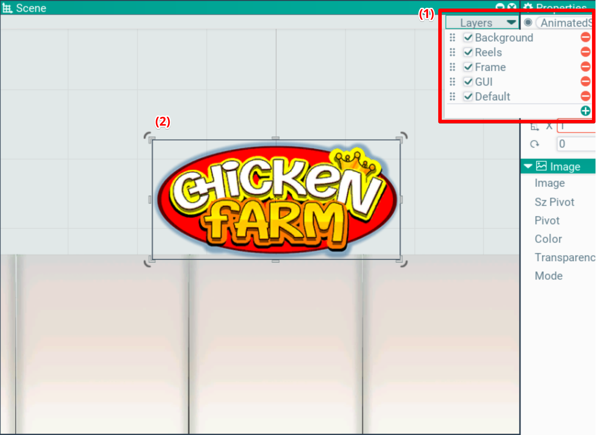

## Scene. Окно сцены

В этом окне отображаются акторы на сцене в порядке расположения на слоях, вне зависимости от камеры. Сцену можно скроллить и зумить. Скролл через зажатую правую кнопку мыши, зум колесиком.

на фоне нарисована сетка. Шаг сетки зависит от зума (степени десяти), каждая десятая линия выделена ярче.

Левой кнопкой мыши можно выбирать акторы. Если кликать в одну точку, выбор происходит циклически от верхнего к нижнему. Таким образом можно выбрать нужную ноду в иерархии кликнув несколько раз.

Так же отображается активный тул (2), выбранный в тулбаре. Он интерактивный, работает так же как и в других редакторах.

У активного тула может включаться специальный режим через зажатике клавиш Shift/Ctrl/Alt. Среди них - снеппинг, выравнивание по осям и др.

### Редактирование сплайнов
Компоненты со сплайном (сплайн-коллайдеры и другие) при выборе в инспекторе активируют тул редактирования сплайна. Точки добавляются двойным кликом, удаляются по Delete. Перетаскивание безье-направляющих точки держит их симметричными; с зажатым Alt они двигаются независимо, а Alt-клик обнуляет направляющую.

У выбранной точки также показывается хендл скругления угла на биссектрисе (как в Illustrator/Figma). Перетаскивание внутрь угла скругляет его: точка смещается по биссектрисе, направляющие ложатся на касательную дуги. Возврат хендла к базовому отступу восстанавливает острый угол. Скругление ограничено половинами соседних рёбер.

### Выбор из объектов под курсором
Клик правой кнопкой (без сдвига вида) открывает меню объектов, видимых под курсором (`ScenePickMenu`): акторов,
которые там рисуют, виджетов, чьи слои там рисуют, и, если дерево их показывает, этих слоёв. Виджет без слоёв только
держит другие, слой другого состояния (сейчас прозрачный, как pressed у кнопки) не виден, камера только обрамляет то,
что показывает, эмиттер частиц рисует только там, где его живые частицы (пустой эмиттер пула не рисует ничего), поэтому
их в меню нет. Масштабированный или повёрнутый виджет попадает под курсор там, где нарисованы его слои.
Меню — дерево только из этих объектов: объект висит на ближайшем предке, который тоже есть в меню, остальные предки
пропускаются. Пункт под мышью обводит свой объект на сцене оранжевым, а слева открывается меню его пропущенных предков,
выстроенное вверх от пункта: корень сверху, ближайший предок — строкой выше пункта; его пункты так же обводят и
выбирают предков. Клик по пункту выделяет его объект, как клик по
сцене, с отменяемым действием.

### Режим вида и навигация
Округлый переключатель 2D | 3D в правом конце верхней панели переключает режимы вида: бегунок съезжает под выбранный. В 3D:
- зажатая правая кнопка — обзор, WASD/QE — полёт;
- зажатая средняя кнопка — орбита вокруг выделенных объектов (центр их габаритов в момент начала; цель вида, если
  ничего не выделено), точка вращения остаётся на своём месте экрана, как в Unity; то же делает Alt + левая кнопка —
  для трекпада;
- Shift + средняя кнопка — панорама;
- колесо — зум.

### Слои
В окне сцены можно настроить слои и их порядок. Для этого нужно кликнуть Layers сверху (1).

В выпадающем меню можно их пересортировать через drag'n'drop, создать новый, удалить старый, переименовать слой через дабл-клик, включить/выключить галкой.

### Гизмо и выделение
Кнопка Gizmos сверху открывает панель управления отображением. Верхняя галка Gizmos выключает гизмо
целиком, ниже список типов акторов и компонент, которые рисуют гизмо: каждый выключается отдельно, перед
названием — иконка компонента (или актора). В
списке те типы, которые переопределили `OnDrawGizmos` и присутствуют на текущей сцене (коллайдеры,
джоинты, камеры) — он собирается по всей сцене, поэтому тип можно выключить до того, как что-то такое
выделено. Гизмо рисуются только у выделенных объектов, вниз по их детям — та же иерархия, что
попадает в обводку выделения — и работают как в 2D, так и в 3D режиме вида.

Последней строкой, под разделителем, идёт галка Selection — она выключает отрисовку выделения
объектов: рамки трансформации и силуэтную обводку выделенного. Обводка рисуется в обоих режимах: в 3D
по контенту 3D-компонент, в 2D — по 2D-графике. В силуэт попадает вся включённая иерархия выделенного
актора — его рисующие компоненты и слои виджетов, а также компоненты и слои всех дочерних объектов,
поэтому выделенная UI-панель обводится по картинкам и текстам внутри неё (в маску рисуются только слои
виджетов, сам виджет целиком не рисуется). Выделенный сам по себе слой виджета обводится отдельно, вместе
со своими вложенными слоями. Выключенные объекты, компоненты и слои пропускаются, как и вложенные слои
выключенного слоя.

### Режим отрисовки
Узкая кнопка режима отрисовки сверху показывает иконку режима и открывает меню режимов, каждый со своей иконкой (`SceneEditScreen::SetRenderMode`, `SceneRenderMode`):
- **Scene camera** (по умолчанию) — через пайплайн первой камеры сцены, поэтому картинка совпадает с игрой.
- **Stable camera** — через дефолтный forward-пайплайн 3D/2D: кастомный пайплайн (offscreen-проходы, экранные шейдеры) может искажать вид при редактировании.
- **Unlit** — дефолтный пайплайн без запечённого освещения 3D-мешей (`ScenePassFilters::SetRawAlbedoMode`); у 2D освещения нет.
- **Wireframe** — рёбра треугольников линиями, без заливки и текстур.
- **Shaded wireframe** — рёбра поверх залитых треугольников.
- **Overdraw** — треугольники складывают постоянный цвет поверх тёмного фона, без текстур: чем ярче, тем больше слоёв там нарисовано.

Все режимы, кроме Scene camera, рисуют через дефолтный пайплайн. Отладочные режимы действуют только на содержимое сцены: сетка, выделение, гизмо и другие окна рисуются как есть (`Render::SetDebugDrawMode`, см. [рендер](/Docs/ru/Architecture/LowLevel/render.md)). Растр векторного спрайта из атласа в Wireframe и Overdraw — два треугольника.

Окно Scene — взгляд на игру: векторные спрайты рисуются с детализацией окна Game (его растром и мешем), и зум увеличивает их как есть, а не растрирует заново; спрайт, который окно Game ещё не рисовало, детализируется как при зуме 100% (`VectorSprite::DetailView`, см. [рендер](/Docs/ru/Architecture/LowLevel/render.md)).