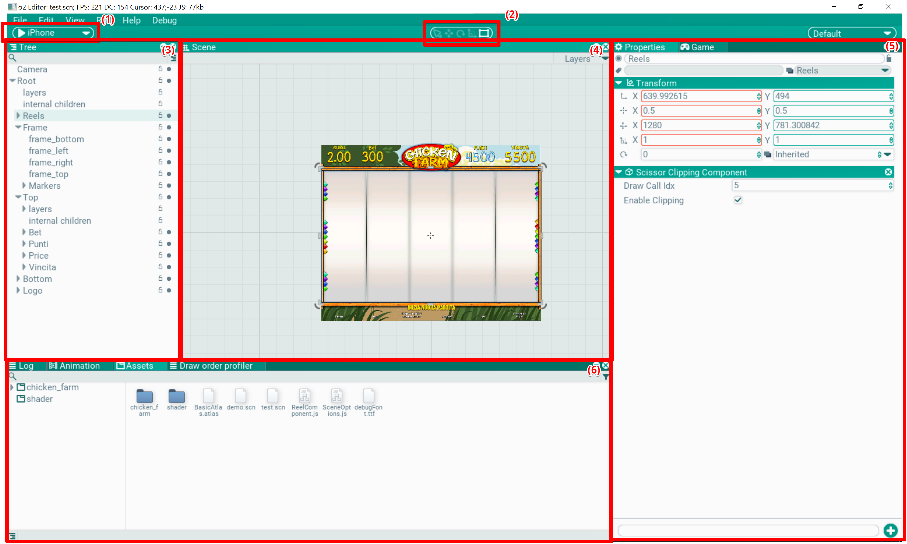

## Редактор

Редактор - это место, где верстается сцена и создается контент для игры. 

В нем есть внутренние окна, которые могут быть прикреплены друг другу, а так же вложены в несколько вкладок. Эти окна можно перемещать, прицеплять к другим окнам (таскать за заголовок окна) и складывать во вкладки (дабл-клик в заголовок).

Редактор может работать в двух режимах: редактирование и игра. В первом режиме сцена загружена, но не получает апдейт и как бы находится в статичном состоянии. В таком режиме ее можно редактировать и сохранять. Во втором режиме - режиме игры - можно проверить работу сцены, все отображаются в редакторе, но происходит обновление и обрабатывает инпут в окне игры. В это время сцену сохранять нельзя.

Изменения сцены можно отменять и повторять: Edit/Undo (Ctrl+Z) и Edit/Redo (Ctrl+Y).

Рассмотрим окна и элементы, которые есть в редакторе в раскладке по умолчанию:

- (1) панель запуска сцены. При нажатии на Play она разворачивается и позволяет поставить игру на паузу (F11) и проиграть один кадр (F10). Справа на панели — управление скоростью игры: кнопки «−»/«+» с текущим множителем между ними переключают скорость апдейта сцены по шкале 0.1, 0.25, 0.5, 0.75, 1.0, 1.5, 2, 3, 5, 10 (замедляется и ускоряется только игра, редактор обновляется как обычно). Те же действия есть в меню Run: Play - stop (P), Frame step (Ctrl/Cmd+P), Speed up (Ctrl/Cmd+«+»), Slow down (Ctrl/Cmd+«−»). Выпадающий список выбора устройства со скриншота устарел и удален — эмулируемое разрешение выбирается в окне Game.

- (2) панель утилит. Выбирается активный тул, который переключает режим редактирования в сцене

- (3) [Tree](/Docs/ru/Editor/Tree/tree.md). Окно иерархии сцены. Показыввает акторы и их детей в сцене

- (4) [Scene](/Docs/ru/Editor/Scene/scene.md). Окно редактирования сцены

- (5) [Properties](/Docs/ru/Editor/Properties/properties.md). Окно настроек выбранного объекта

- (5) [Game](/Docs/ru/Editor/Game/game.md). Окно игры, эмулирует вывод графики и обработку ввода как будто приложение запущено отдельно

- (6) [Assets](/Docs/ru/Editor/Assets/assets.md). Окно ассетов, в нем можно перемещать, редактировать и просматривать ассеты

- (6) [Log](/Docs/ru/Editor/Log/log.md). Окно лога, в него выводятся отладочные сообщения

- (6) [Animation](/Docs/ru/Editor/Animation/animation.md). Редактор анимации, в нем редактируются ключи, параметры и кривые

- [Pipeline](/Docs/ru/Editor/Pipeline/pipeline.md). Нодовый редактор AI-пайплайнов контента; открывается на ассете пайплайна и сохраняет сгенерированные файлы в папку ассетов. [Устройство](/Docs/ru/Editor/Pipeline/internals.md): граф, исполнитель, ноды и провайдеры

### Стиль UI редактора
Внешний вид виджетов редактора строится кодом (`EditorUIStyleBuilder`, `EditorUIStyle.cpp`) и кэшируется прототипами в `o2/Editor/Assets/Editor UI styles`, тёмная тема - в `Editor UI styles dark` (не в git). Кэш загружается только если его собранная копия в `BuiltAssets/<platform>/EditorData` сгенерирована из текущего `EditorUIStyle.cpp` (тёмная - ещё и из текущего `EditorTheme.cpp`) и все его образцы загружаются; иначе редактор пересобирает стиль в памяти (около 0.1 с) и обновляет сохранённые прототипы, которые попадут в собранную копию при следующей сборке таргета `Editor`.

### Темы
У редактора две темы: светлая, вид o2 (по умолчанию), и тёмная, вид AssetsLine. Тема выбирается в Edit/Preferences (`Theme`) или View/Theme/Light, Dark. Она применяется после перезапуска: редактор просит подтвердить, сохраняет выбор (`theme` глобального конфига, `Config.json`) и до следующего запуска остаётся в прежнем виде; при отказе настройка возвращается назад. Окно Pipeline следует теме редактора.

- Как сделана тёмная тема (`UI/Style/EditorTheme.*`, `EditorThemeDark.h`, `EditorThemeDarkArt.cpp`). Единственный источник - светлые графика и стили. При тёмной теме SVG редактора перекрашиваются при загрузке (`VectorImageAsset::SetImageRemap`) по роли картинки:
  - поверхности (кнопки, поля, боксы, списки, меню, вкладки, панели) получают тёмные цвета поверхностей; при наведении они светлее и с более сильной кромкой, нажатые утапливаются, в фокусе - кромка акцента, как в светлой теме; у приподнятых элементов и всплывающих окон - градиенты AssetsLine;
  - выделение, нажатые пункты меню и включённое - глубокий фиолетовый, у показанной вкладки и заголовков окон сверху линия акцента - там, где у светлой темы бирюза;
  - иконки получают один яркий цвет глифа, белый при наведении, акцент при нажатии, приглушённый у неактивных; значащие цвета (ошибки, предупреждения, оси) сохраняются; светлая часть, вырезанная из более тёмного глифа, получает цвет панели;
  - круглые кнопки - диск со знаком: белые диски светлой темы (кнопки заголовков окон) становятся нейтральными, бирюзовые - глубоким фиолетовым; при наведении диск светлее, при нажатии фиолетовый;
  - картинки со своим фоном (иконки файлов и подобные) остаются как есть, картинки проекта не трогаются.

  После билдеров стилей `EditorTheme::RecolorStyles` проводит каждый образец стиля через его сериализованную форму и заменяет светлые цвета их ролями (`StyleColor`), так что меняются и цвета состояний и анимаций. То, что код редактора рисует сам (виды, кривые, таймлайн, метки лога, дерево, инструменты, шахматка), берёт цвета из `EditorTheme::Get()` - `EditorPalette` своей темы.
- Тесты: `o2EditorTests/EditorTheme` (палитры, имена, конфиг), `o2EditorTests/EditorThemeChoice` (вопрос о перезапуске сохраняет подтверждённую тему и возвращает отклонённую), `o2EditorUITests/EditorThemeSwitch` (светлый вид не меняется после загрузки тёмного, тёмный кадр тёмный, каждый стиль обеих тем сохраняется читаемым, графика проекта сохраняет цвета). `EditorThemeGallery` с `O2_EDITOR_THEME_OUT=<папка>` сохраняет редактор, диалоги, меню, настройки, каждый стиль виджетов и каждую картинку графики (`art_*`) в обеих темах.

### Векторная графика UI редактора
Редактор рисует UI векторными изображениями: у каждого спрайта `X.png` в `o2/Editor/Assets/ui` есть пара `X.svg` (`VectorImageAsset`, рисуется `VectorSprite` обычными треугольниками с цветом в вершинах, см. [рендер](/Docs/ru/Architecture/LowLevel/render.md)). `.svg.meta` повторяет `sliceBorder` и `defaultMode` из `.png.meta`; PNG остаются как растровые оригиналы.

- Код создаёт drawable как `mmake<VectorSprite>("ui/X.svg")` и меняет картинки через `WidgetLayer::SetImage`, `Widget::SetLayerImage`, `Button::SetIconImage`, а не `mmake<Sprite>("ui/X.png")`. Растр остаётся там, где вектор не работает: текстуры, построенные кодом (шахматка, выбор цвета, превью, render target), `ui/pipeline/checker.png` (tiled) и `ui/UI4_animation_bar.png` (угловые цвета).
- Инструменты, `o2/Tools/VectorUI` (см. `README.md` там): `ai_to_svg.py` конвертирует исходник Illustrator, `fit_check.py` сверяет каждый SVG с его PNG движковым растеризатором, `import_svgs.py --src <dir>` копирует подогнанные SVG рядом с PNG и пишет `X.svg.meta` со стабильным id, вычисленным из пути. Меты и id PNG не меняются никогда.
- Тесты.
  - `o2SystemTests/EditorVectorSprites` (headless, идёт на CI): каждый `X.svg` растеризуется программно и сравнивается с `X.png` на сером, белом и чёрном фоне (сходство >= 0.98 при допуске 24, средняя разница <= 3; спрайт ниже порога должен быть перечислен в тесте со своим порогом); размер изображения и мета совпадают с PNG; каждый путь `"ui/..."` в исходниках редактора и фреймворка указывает на существующий ассет и использует векторную пару, если она есть.
  - `o2EditorUITests/EditorVectorUIParity` (настоящее окно и GPU, исключён на CI): рисует один и тот же UI вектором и с подменой каждого векторного спрайта на `Sprite` его PNG-пары (тест подменяет drawable стилей и дерева виджетов) в одном процессе и требует >= 99% совпавших пикселей при допуске 4. Сцены: весь редактор (меню, панель инструментов, пристыкованные окна в трёх раскладках вкладок, маленькая сцена с выделенным актором, фиксированные сообщения лога), диалоги и контекстное меню поверх него, галерея всех стилей виджетов во всех состояниях. Каждый проход пересобирает стиль в памяти и создаёт все окна заново; состояния доводятся фиксированным шагом времени, курсор убран. Кадры и их разница сохраняются в `build/o2/TestScreenshots/vector_parity/<сцена>_raster.png`, `_vector.png`, `_diff.png`; печатается сходство при допусках 0, 2, 4, 8, 16, 24.
- Известные отличия от растра: спрайт, стоящий между пикселями или нарисованный меньше своего изображения, в растре размыт фильтрацией текстуры, а в векторе получает точное покрытие краёв (линия времени окна анимации, ползунки скроллбаров, знак `UI4_o2_sign` 70 px, рисуемый в 18 px).
